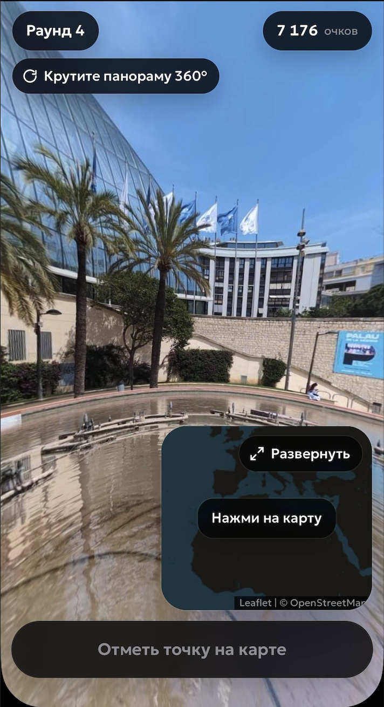
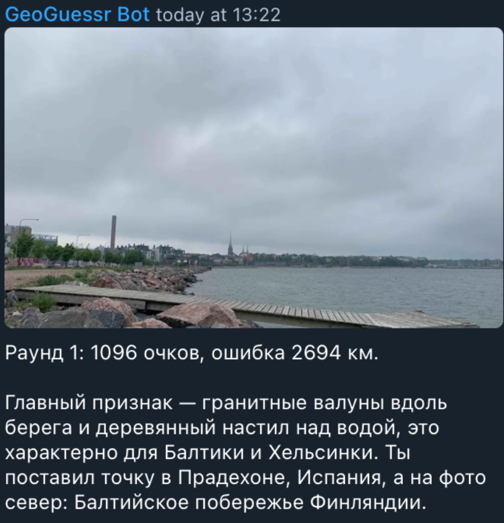
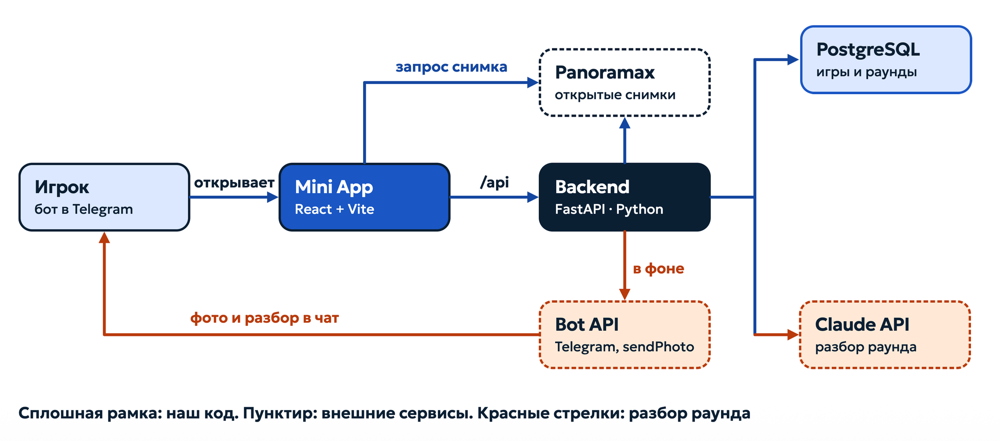

# 🌍 GeoGuessrBot

### Географическая игра в формате Telegram бота

**GeoGuessrBot** — телеграм бот версия популярной игры GeoGuessr. В этой игре, пользователь пытается угадать точку на карте, где было снято то или иное изображение. Приложение было создано, как способ получить доступ к версии любимой игры быстро и удобно.

---
## 🎯 Демонстрация

- 🎥 [Промо-видео](https://drive.google.com/file/d/1u0zihLZccTW_XWF3wFbnCfEjRdPZN4XF/view?usp=sharing)
- 📊 [Презентация проекта](https://drive.google.com/file/d/1_ZSjylJC0pL0wtuU1aBHUPBSu0T9ju6E/view?usp=sharing)

## Возможности

- 🌎 **Исследование мира** — панорамамы со всего мира.
- 📍 **Выбор региона** — позволяет ограничеть игровую область конкретным регионом или городом, чтобы регулировать сложность.
- 🔭 **Панорамы 360°** — возможность исследовать локацию со всех сторон.
- 🗺️ **Интерактивная карта** — возможность указывать местоположение прямо на карте.
- ⏻ **Сохранение прогресса** - При выходе из игры прогресс сохраняется и есть возможность продолжить незавершённую игру.
- 🤖 **AI-анализ ошибок** — после заверщения игры можно получить разбор ошибок от нейросети.

## 🎮 Использование

Одна игровая сессия состоит ровно из **5 раундов**.

1. **Выбор режима игры.** Игрок указывает в какой локации он хочет играть, можно выбрать весь мир, конретный город или страну.
2. **Исследуйте панораму.** Затем игроку показывается основной экран раунда. На нем панорама, которою можно вращать 360°, сумма очков за игру и карта.

3. **Сделайте предположение.** Далее игрок на интерактивной карте отмечает место, где, как он думает, была сделана фотография.
4. **Получите результат.** Система сравнит выбранные координаты с реальным местоположением, рассчитает расстояние между ними и в зависимости от этого начисляет очки.
5. **Проанализируйте ошибку.** По окончанию игры, игрок может запросить объяснение от нейросети. Она укажет на особенности, которые могли помочь определить правильное местоположение


После пятого раунда игра автоматически завершается, а пользователю отображается итоговый счёт.

## 💻 Архитектура

Приложение построено на основе клиент-серверной архитектуры и состоит из нескольких основных компонентов:


### Основные компоненты

**Telegram Bot**
- Точка входа в приложение.
- Взаимодействие с пользователем.
- В том числе, отправка разбора от исскуственного интелекта
- Запуск Telegram Mini App.

**Frontend**
- Отображение игрового интерфейса.
- Выбор игрового режима и региона.
- Отображение панорам 360°.
- Взаимодействие с интерактивной картой.
- Наглядное сравнение ответа
- Передача ответов пользователя.
- Отображение результатов.

**Backend**
- Обработка входящих запросов.
- Валидация входных данных.
- Реализация игровой логики.
- Вычисление расстояния между координатами.
- Расчёт игровых результатов.
- Взаимодействие с базой данных.

**Database**
- Создание базы данных
- Инициализация и заполнение данными

**Panoramax Integration**

В данном проекте в качестве источника изображений используется открытая библиотека . Backend получает необходимые данные через Panoramax Rest API, обрабатывает их, подбирает подходящее изображение, после чего frontend использует Panoramax для получение самого изображения.

**AI Integration**

Нейросетевой модуль анализирует ответы пользователя и предоставляет пояснения к ошибкам, помогая определить, какие визуальные признаки могли бы привести к правильному ответу.

### Используемые технологии
**Frontend**
* CSS: Графика
* React: управление взаимодействием, настройка бота
* Vite: сборка

**Backend**
* Python 3.12+
* Panoramax: Получение панорам
* FastApi: HTTP сервер
* Pydantic 2.x: Валидация данных

**Database**
* PostgreSQL 16+

**Тестирование**
* Pytest
* Locust

**Сбока** 
* Docker

## 🚀 Запуск проекта

### Требования

Всё что вам потребуется для запуска, это Docker для сборки контейнера и cloudflare для настройки доступа между ботом и Mini App

Вместо cloudflare можно использовать иной сервис для настройки тоннелей.

## Сборка

2. Склонируйте этот репозиторий:

   ```bash
   git clone git@github.com:Arishkamu/GeoGuessrBot.git
   cd GeoGuessrBot
   ```

2. Заполните `.env`. Используйте шаблон: `.env.example`

3. В отдельном терминале запустите HTTPS-туннель:

   ```bash
   cloudflared tunnel --protocol quic --url http://localhost:8000
   ```

   Запишите полученный адрес `https://….trycloudflare.com` в `WEBAPP_URL`
   в `.env`. Оставьте терминал с туннелем открытым.

4. Соберите и запустите бота, БД, backend и frontend:

   ```bash
   docker compose up --build -d postgres backend front tg_bot
   ```

   * Frontend: http://localhost:8000. 
   * Проверка API: http://localhost:8080/api/status.

5. Откройте [бота](https://t.me/i_guess_geo_bot) в Telegram, отправьте `/start` и нажмите «Играть».
   
   Если сменился адресс туннеля обновите `WEBAPP_URL` и выполните
   `docker compose up -d tg_bot`.

## 🎯 О проекте

GeoGuessrBot объединяет игровые механики географических викторин, интерактивные панорамы и возможности искусственного интеллекта.

**Стань лучшей версией себя! Умнее. Образование. Географичнее!** 🌍

---

Данный проект был разработан в рамках учебного хакатона ИТМО 2026 (ITMO devDays-26)

---
Работники (года)хакатона:
* [Иванова Арина](https://github.com/Arishkamu), backend api, panoramas researcher, panoramax integration, sleep shedule control
* [Екатерина Исаева](https://github.com/karambo3a), backend logic, git and docker master(DevOps), vidio maker
* [Екатерина Исаева](https://github.com/eduardkr967-ui), database dev, backend db, software tester
* [Екатерина Исаева](https://github.com/azizabobojonova), tg-bot, ui, frontend developer, Claude integration
