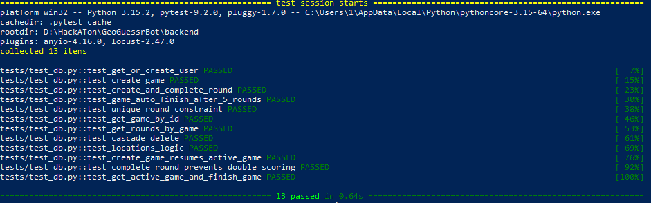
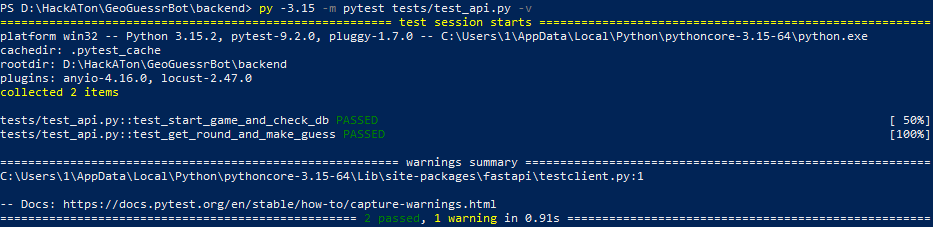
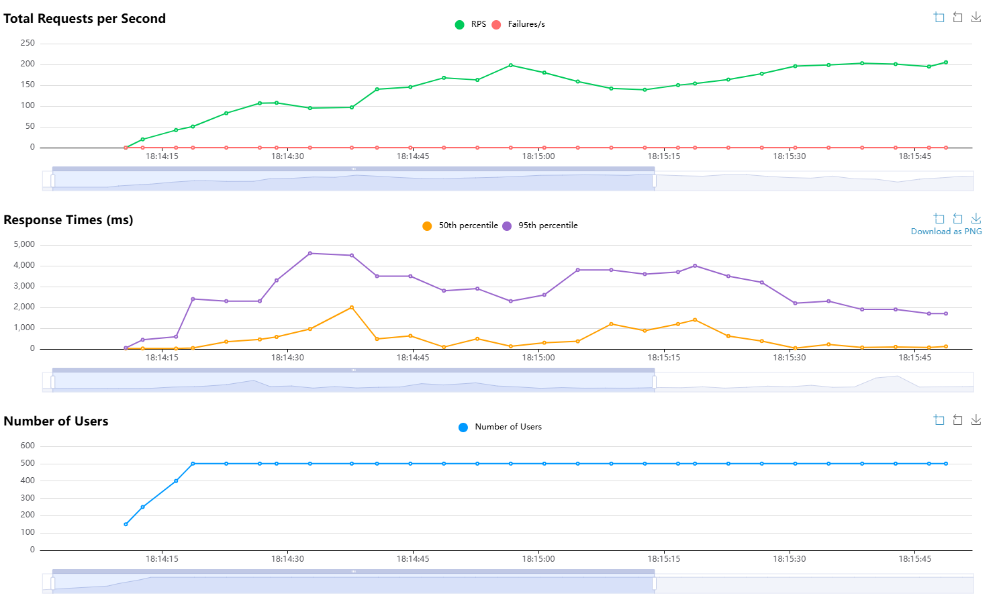

# Отчет о тестировании

## Использованные инструменты
* **pytest** — фреймворк для написания модульных и интеграционных тестов.
* **FastAPI TestClient** — для виртуального вызова эндпоинтов без реального запуска сервера.
* **Locust** — для нагрузочного тестирования.
* **PostgreSQL + Docker** — база данных.

---

## 1. Модульное тестирование
**Файл:** `tests/test_db.py`
**Запуск:** `pytest tests/test_db.py -v`
**Цель:** Проверить корректность работы функций базы данных, транзакций и ограничений (constraints), изолированно от веб-сервера.

**Что покрыто тестами (9 тестов):**
* Создание пользователя и игры.
* Создание и завершение раунда.
* Проверка начисления очков.
* Автоматическое завершение игры после 5 сыгранных раундов.
* Защита от дублирования раундов.
* При удалении пользователя удаляются его игры и раунды.
* Получение игры и списка раундов.
* Работа с локациями и привязка их к игре.

---

## 2. Интеграционное тестирование
**Файл:** `tests/test_api.py`
**Запуск:** `pytest tests/test_api.py -v`
**Цель:** Проверить связку Сервера и Базы данных. Убедиться, что API действительно сохраняет данные в PostgreSQL.

**Что покрыто тестами (2 теста):**
* Проверка эндпоинта `POST /api/game/start`: после запроса к API в БД появляется новая игра и пользователь.
* Полный игровой цикл: Старт игры -> Получение раунда `GET /api/round/{id}` -> Отправка догадки `POST /api/guess/{id}`. Проверяется, что после отправки ответа в БД корректно обновился счет игры (`total_score`) и счетчик раундов.

---

## 3. Нагрузочное тестирование
**Файл:** `tests/test_locust.py`
**Запуск:** `locust -f tests/test_locust.py --host=http://127.0.0.1:8000`
**Цель:** Проверить стабильность API и пула соединений с БД под высокой одновременной нагрузкой.

**Сценарий тестирования:**
* Генерация валидных подписей Telegram для каждого виртуального пользователя.
* Имитация 500 одновременных игроков.
* Сценарий: проверка статуса сервера, старт новой игры, запрос раундов.

**Результаты:**
* Сервер стабильно выдерживает нагрузку в ~200 запросов в секунду (RPS).
* Количество ошибок: 0.
* Медианное время отклика (50-й перцентиль) не превышает 1000 мс.
* 95-й перцентиль имеет всплески до 5000 мс, что не приводит к отказу сервера благодаря настроенному пулу соединений `psycopg_pool`.

 